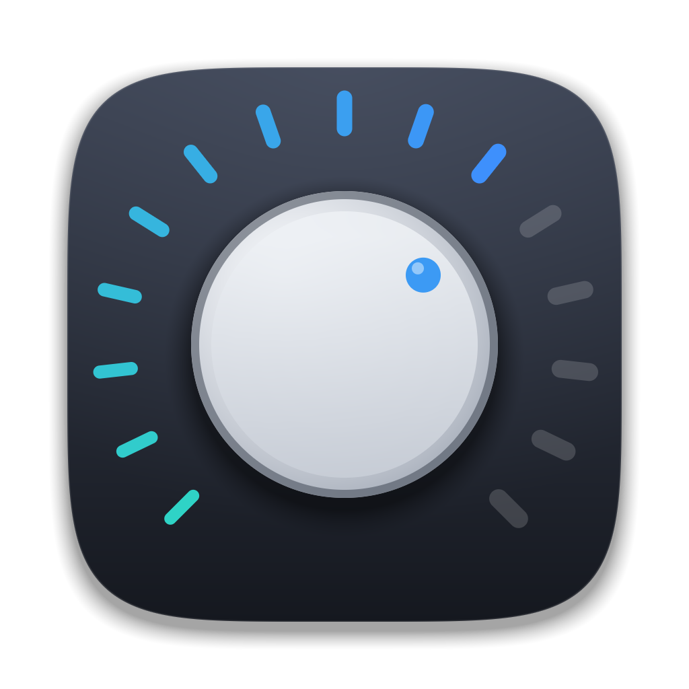

# ScreenKnob

A small macOS menu bar app that gives **HDMI and DisplayPort screens a working volume control**:
the slider, the keyboard volume keys, and macOS's own volume popup and click sound — the same
as built-in speakers. On a Mac, monitors normally ignore the volume keys and show a "no volume
control" symbol, because their speakers have a fixed level.

It's built to stay stable when screens go to sleep, wake up or switch inputs: it notices the
change, moves sound to another speaker while the screen is away, and switches back when it returns.

## What it does

- **Volume for screens without their own control** (HDMI, DisplayPort, Thunderbolt displays).
  Speakers that do have a volume control (built-in, USB, Bluetooth) keep using it.
- **macOS volume popup and click** for those screens, through the free BlackHole 2ch virtual speaker
  (see below). Without BlackHole, the volume keys still work; you just won't see the popup.
- **Remembers your chosen output** and goes back to it after the screen sleeps, wakes or changes input.
- **Menu bar icon** with Louder, Quieter, Mute and the current output; closing the window keeps it running.
- Follows light and dark mode and your accent color.

## Requirements

- macOS 14.2 (Sonoma) or newer. Apple silicon or Intel.
- Optional but recommended: **[BlackHole 2ch](https://github.com/ExistentialAudio/BlackHole)**
  (free), for the native volume popup and click.
- To build it: the Rust toolchain (free, see step 1).

## Install

### Easiest: download the app

1. Download `ScreenKnob-<version>.dmg` from the [Releases page](https://github.com/davemadan/screenknob/releases).
2. Open it and drag **ScreenKnob** onto **Applications**.
3. Open ScreenKnob from Applications. macOS will say it can't check the app (it's signed locally,
   not by Apple). Open **System Settings → Privacy & Security**, scroll down and click **Open Anyway**
   next to ScreenKnob, then confirm.
   (Or, in Terminal: `xattr -dr com.apple.quarantine /Applications/ScreenKnob.app`.)
4. Optional: install BlackHole 2ch for the native popup (see step 2 below), then read *First launch*.

### Or build it yourself

#### 1. Install Rust (once)

```sh
curl --proto '=https' --tlsv1.2 -sSf https://sh.rustup.rs | sh -s -- -y --profile minimal
source "$HOME/.cargo/env"
```

#### 2. Optional: install BlackHole 2ch (for the native popup)

With [Homebrew](https://brew.sh):

```sh
brew install blackhole-2ch
```

or download the installer from the BlackHole page. You may need to restart your Mac afterwards.

#### 3. Build and install ScreenKnob

```sh
git clone https://github.com/davemadan/screenknob.git
cd screenknob
./scripts/make-app.sh --install
```

This builds `ScreenKnob.app` and copies it to your Applications folder. To only build it (into
`dist/ScreenKnob.app`), leave out `--install`. `./scripts/make-dmg.sh` also makes the
downloadable disk image in `release/`.

### First launch

Open **ScreenKnob** from Applications (a copy you built yourself opens straight away).

ScreenKnob asks for two permissions. Both are needed for screens without a volume control:

| Permission | Where | Why |
|---|---|---|
| **System Audio Recording** | Privacy & Security → Screen & System Audio Recording | ScreenKnob passes your Mac's sound through itself to set the screen's level. Nothing is recorded or saved. |
| **Accessibility** | Privacy & Security → Accessibility | Only used without BlackHole, so the keyboard volume keys can control the screen. |

ScreenKnob doesn't use the microphone.

### Start at login (optional)

System Settings → General → **Login Items** → **+** → choose ScreenKnob.

## Using it

- Click the speaker icon in the menu bar for Louder / Quieter / Mute, or **Open ScreenKnob…** for the window.
- In the window, pick the output under **Output device**, set the level with the slider, and switch options:
  - **Software volume** — volume for screens without their own control.
  - **macOS volume popup** — routes screens through BlackHole 2ch so macOS shows its own popup and click.
    While this is on, your Mac's sound output shows as "BlackHole 2ch"; that's expected.
  - **Volume keys** — the keyboard keys for those screens (when the popup option is off).
  - **Return to chosen output** — switch back to your screen after it sleeps, wakes or changes input.
- **Quit** from the menu bar icon. Quitting hands the sound back to your screen directly.

## Troubleshooting

- **No sound after ScreenKnob was force-quit:** your output may still be set to BlackHole 2ch.
  Open ScreenKnob again, or pick your screen in Control Center → Sound.
- **Volume keys don't work:** in the window, use **Reset & Ask Again** and allow ScreenKnob under Accessibility.
- **"isn't taking sound right now":** the screen is asleep or showing another input; ScreenKnob keeps
  checking and picks it up again when it's back.
- A short log is kept at `~/Library/Logs/ScreenKnob.log`.

## Uninstall

Quit ScreenKnob from its menu bar icon, then delete `/Applications/ScreenKnob.app`. To remove its
settings and log too, delete `~/Library/Application Support/ScreenKnob` and `~/Library/Logs/ScreenKnob.log`,
and remove it from the Privacy & Security lists.

## How it works

ScreenKnob captures the Mac's sound with a Core Audio process tap and plays it on the screen through a
private aggregate device, scaling it by the volume you set. With the popup option on, BlackHole 2ch is set
as the Mac's output: macOS sees a speaker with a real volume control, so its own keys, popup and click
work, and ScreenKnob plays the sound on the screen at BlackHole's volume. All audio objects are owned by
one worker thread; device changes are re-read rather than cached, and failed starts are retried, which is
what keeps it stable through sleep, wake and input switches.

Written in Rust with [egui](https://github.com/emilk/egui).

## License

MIT — see [LICENSE](LICENSE).
